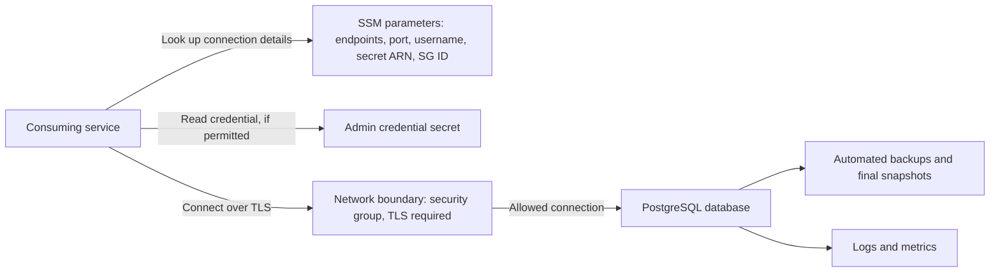
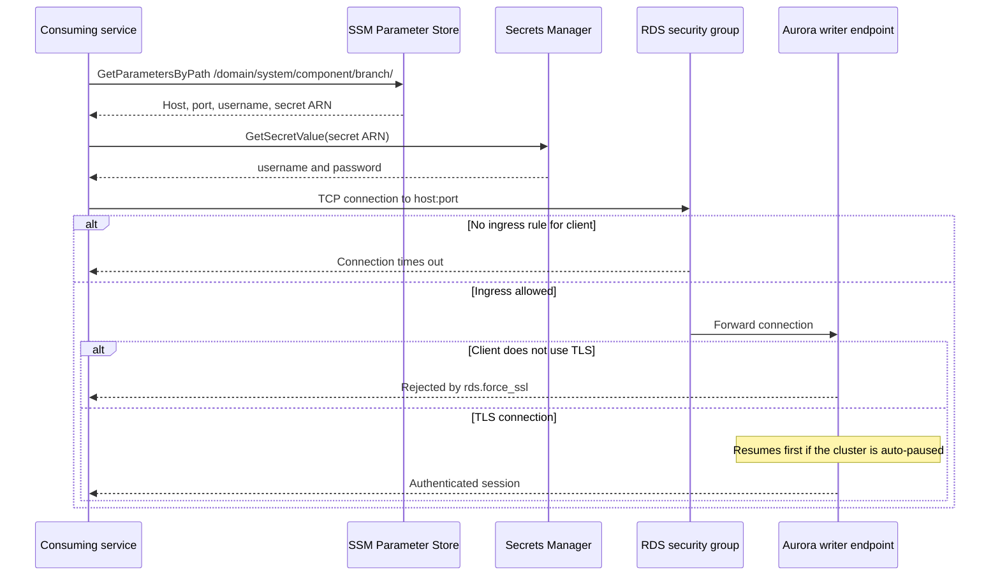
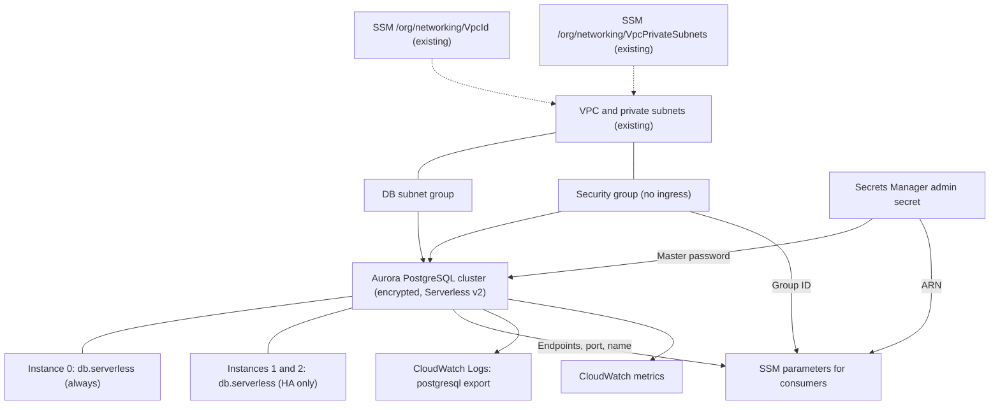
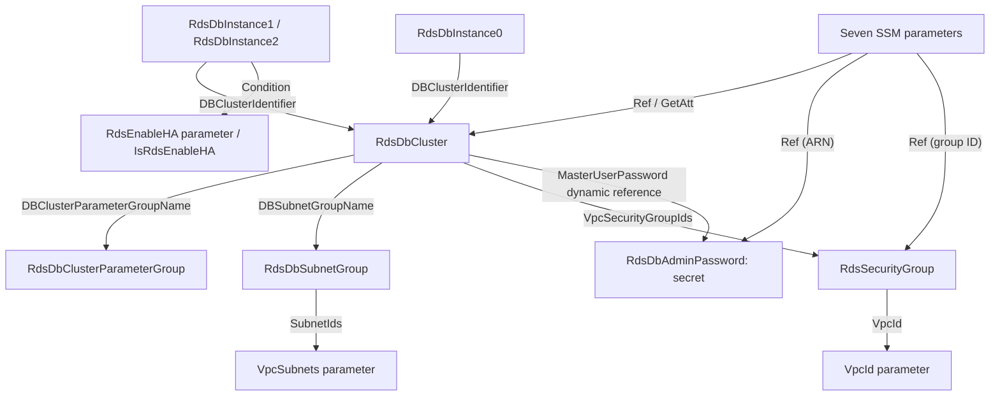

# Architecture

## Infrastructure

### Logical architecture

The stack provides a managed PostgreSQL database and publishes what consumers
need to reach it:

- The database cluster stores data and serves connections on a writer endpoint
  and a reader endpoint.
- The network boundary admits only clients explicitly allowed by a security
  group rule; the starter allows none.
- The admin credential is generated and held in a secret, never in source.
- SSM parameters publish endpoints, port, username, secret ARN, and security
  group ID under a predictable path for consumers.
- Logs and metrics expose connection and engine behavior for operations.

This stack does not create database roles, schemas, or application users.
Those belong to the consuming services or a separate migration process.

#### Logical architecture diagram



#### Connection call sequence

This example assumes a consumer in the same VPC whose security group has been
granted ingress, and whose IAM role may read the SSM parameters and the secret.



Applications should replace the admin credential in this sequence with their
own role's credential once one exists.

### Physical architecture



`template.yaml` owns the secret, cluster parameter group, cluster, instances,
DB subnet group, security group, and SSM parameters. The VPC, subnets, the two
`/org/networking/` SSM parameters, the AWS-managed KMS key, and CI roles are
external dependencies.

### CloudFormation template

`template.yaml` is the infrastructure-as-code entry point. It declares
`Transform: AWS::Serverless-2016-10-31` so it can be built and deployed with the
SAM CLI, but it contains only plain CloudFormation resources.

| Section | Purpose |
| --- | --- |
| `Parameters` | Supplies domain/system/component metadata, branch name, engine settings, capacity, backup and maintenance settings, HA flag, and SSM-resolved VPC and subnets. |
| `Conditions` | `IsRdsEnableHA` is true when `RdsEnableHA` is `"true"`. |
| `Resources` | Declares the secret, parameter group, cluster, instances, networking, and SSM parameters. |

There are no `Outputs`; the SSM parameters are the published interface.

#### Template resource relationships

Arrows below run from the referencing resource to its target; they show
infrastructure references, not connection flow.



`cfn-parameters.json` and `cfn-tags.json` provide deployment-action inputs,
while `samconfig.toml` supplies SAM deployment defaults. See
[Configuration](03-configuration.md) for their expression syntax and external
prerequisites. Validate changes with `sam validate --lint` and run `sam build`
before deployment.

## Software

### Repository file layout

```text
catalog-info.yaml       Backstage Component entity
mkdocs.yml              TechDocs site configuration
docs/handbook/          Handbook pages
README.md               Project entry point
template.yaml           SAM/CloudFormation infrastructure
cfn-parameters.json     Deployment-action parameter expressions
cfn-tags.json           Deployment-action tag expressions
samconfig.toml          SAM deploy defaults
.cfnlintrc              CloudFormation lint configuration
.github/workflows/      main.yml and branch.yml
```

These are generated-project paths. The template source repository keeps their
inputs under `skeleton/` and `pipeline/` before the scaffolder combines them.

There is no application code, test suite, or dependency manifest. Database
schemas and migrations are not part of this repository unless you add them.

### Anatomy of the cluster

| Resource | Purpose |
| --- | --- |
| `RdsDbCluster` | The Aurora cluster: engine, version, port, optional initial database, admin credential, capacity range, encryption, log export, and backup settings. Storage and endpoints belong to the cluster. |
| `RdsDbInstance0` | Always-created `db.serverless` instance. Without HA it is the writer. A cluster needs at least one instance to accept connections. |
| `RdsDbInstance1`, `RdsDbInstance2` | Created only when `RdsEnableHA` is `"true"`. CloudFormation may create the three instances in parallel, so any of them can become the writer; the others serve the reader endpoint and are failover targets. |
| `RdsDbClusterParameterGroup` | Cluster-level engine settings. Changing static parameters requires an instance reboot to take effect. |

All instances share the cluster's Serverless v2 capacity range and each is
billed for the ACUs it uses. The template does not set `PromotionTier`; readers in
the default tier scale with the writer so they can take over after a failover.

### Anatomy of the credential

1. CloudFormation creates `RdsDbAdminPassword` with a generated password.
2. `RdsDbCluster.MasterUserPassword` resolves the secret's `password` key through a
   Secrets Manager dynamic reference when the cluster is created or updated.
3. `RdsDbAdminPasswordSsmParam` publishes the secret's ARN so consumers can find it.
4. Consumers read the secret value with `secretsmanager:GetSecretValue`, which the
   stack does not grant to anyone. Access is controlled by IAM in the consumer's
   account and role.

CloudFormation does not watch the secret's value. Changing the password outside
CloudFormation does not update the cluster, and later stack updates do not
reset it unless the template changes the `MasterUserPassword` property.

### Anatomy of the network boundary

`RdsDbSubnetGroup` places the cluster in the private subnets and
`RdsSecurityGroup` controls inbound traffic. The security group has the default
allow-all egress rule and no ingress rules. Granting access means adding an
ingress rule on port `${{ values.db_port }}` whose source is the consumer's
security group, typically in the consumer's own stack using the group ID from
`RdsSecurityGroupId`.

### SSM parameter naming

```text
/<Domain>/<System>/<Component>/<CodeBranch>/<Name>
```

For this component on `main`:

```text
/${{ values.domain_name }}/${{ values.system_name }}/${{ values.component_name }}/main/RdsDbClusterHost
```

`Component` comes from the repository-name slug and `CodeBranch` from the
branch-name slug at deployment time. Consumers can read all values at once with
`GetParametersByPath` on the prefix, or individually by full name.
